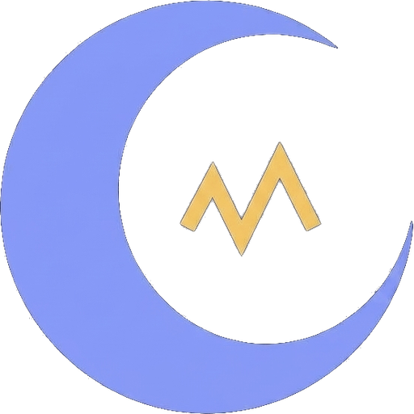

<p align="center"></p>

<h1 align="center">OpenLucid</h1>

**An open-source dream machine you can build yourself.**

You put on a [Muse](https://choosemuse.com/) EEG headband and go to sleep. An app listens to your brainwaves. A small program on your own laptop guesses your sleep stage. When it is fairly sure you are dreaming, it plays a soft sound that you trained yourself, that evening, to link with the question *"Am I dreaming?"*. And if you realize you are, you can signal back from inside the dream with your eyes: left, right, left, right.

Will it give you lucid dreams? Honest answer: maybe, sometimes. Sound cues during REM sleep (*targeted lucidity reactivation*) have helped some people in lab studies; at home the evidence is weaker. OpenLucid is a tool to find out, honestly, what works for you.

**Website:** [openlucid.nl](https://openlucid.nl) · **Download:** [Windows preview](https://github.com/emolionl/openlucid/releases) · **Build diary:** [the journey](https://openlucid.nl/journey/)

> **Educational, not medical advice.** A Muse is a consumer gadget, not a medical device. OpenLucid does not diagnose or treat anything. Sound cues only: no electricity goes into anyone's head.

## Download

The goal is to make this as easy as possible: download, run the installer, done. It updates itself after that.

| Part | Platform | Status |
|---|---|---|
| The app | Windows | **Preview**: [download the installer](https://github.com/emolionl/openlucid/releases) and run it |
| The app | Android | Builds from the code; not tested with a headband yet |
| The app | iPhone and iPad, Mac, Linux | Later, from the same Flutter code |
| The Diary Keeper (server) | Any computer with Python 3.11+, or Docker | Works; you start it yourself (below) |

Windows may say "Windows protected your PC" because the app isn't signed yet: click **More info**, then **Run anyway**.

What the preview does: live brainwaves, a contact check per sensor, an eye check, and **recording a whole night** (EEG plus head movement, saved locally as EDF+ in a BIDS-EEG folder). Sleep stages and sound cues come next.

## Architecture

**The app is one Flutter codebase**, not rewritten per platform — Windows today, Android/iPhone and iPad/Mac/Linux from the exact same code as each is tested and shipped.

**The Diary Keeper is Python**, on purpose: sleep-staging and EEG-analysis models — [YASA](https://github.com/raphaelvallat/yasa), the lab's own `ezscore-f` and `eegFloss` — are published in Python first, so the server can call them directly, no porting required.

```
Flutter app   →  Diary Keeper (Python)  →  SQLite file            (solo, default)
Flutter apps  →  Diary Keeper (Python)  →  PostgreSQL in Docker   (a few people, opt-in)
```

Same code either way — see "The Diary Keeper (backend)" below for how to switch.

## What's in here

```
openlucid/
├── backend/            The Diary Keeper: Python + FastAPI + SQLite, runs on your laptop
├── frontend/
│   ├── desktop/        The app: Flutter (Windows, Android, macOS, Linux), talks to the Muse over Bluetooth
│   └── web/            The morning view: Vue, your night's report and dream journal in the browser
├── tools/              Python scripts that check recordings with MNE, the way researchers do
├── website/            The project website (openlucid.nl): Hugo, static, hosted on Firebase
├── docs/journey/       The build diary: every step we took, including the wrong turns
├── docs/research/      What science knows, which devices exist, what they cost (with sources)
├── docs/agentic/       Lessons on building software with AI agents, using this project as the example
├── promotion/          Video scripts and the animated series "Are You Dreaming?"
└── branding/           The logo and the script that makes every icon size
```

**Follow the build:** start with [the journey](docs/journey/README.md). It's written for beginners, and the mistakes are in there too.

Everything runs locally. Your brain data never leaves your computer.

## Run it from the code

You need [Flutter](https://docs.flutter.dev/get-started/install) for the app and [Python 3.11+](https://www.python.org/downloads/) for the Diary Keeper and the tools.

**The app:**

```bash
cd frontend/desktop
flutter run -d windows            # or -d android, -d macos, -d linux
flutter build windows --release   # the same build as the download
```

**The Diary Keeper** (Windows PowerShell; on macOS/Linux use `source .venv/bin/activate`):

```powershell
cd backend
python -m venv .venv
.\.venv\Scripts\activate
pip install -r requirements.txt
uvicorn app.main:app --reload
```

Open <http://localhost:8000/health>. It should say *"The Diary Keeper is awake."*

**Check a recorded night** with MNE:

```powershell
python -m venv tools\.venv
.\tools\.venv\Scripts\activate
pip install -r tools/requirements.txt
python tools/check_night.py "<the night's folder>"
```

**The morning view** (browser): `cd frontend/web`, `npm install`, `npm run dev`.

## The Diary Keeper (backend)

The backend keeps your nights, 30-second epochs, events, dream journal and recording files, behind a login.
It runs in two ways from the same code:

- **Local mode** (the default): on your own laptop with SQLite. Nothing to install besides Python, and your data
  stays in `backend/data/`.
- **Server mode** (opt-in): PostgreSQL and the API in Docker, started with `docker compose up -d --build`, for a
  few people on one server. The first account becomes the admin.

Other people's EEG and sleep data is health data: if you run a server for others, read the privacy section first.
Setup, every setting, tests and that privacy section are in [backend/README.md](backend/README.md).

## Roadmap

Each step is a checkpoint (a git tag such as `checkpoint-03`), so you can always jump to a working version.

| Checkpoint | What it adds |
|---|---|
| 00 ✅ | App, web view and server say hello |
| 01 ✅ | Any EEG source; Muse S over Bluetooth, Fake Moose, live view with contact score, eye check |
| 02 ✅ | The Diary Keeper: multi-user backend with login, nights, epochs, events, journal, recordings; SQLite locally, PostgreSQL on a server |
| 03 🔨 | Record a whole night in the app ✅ (EDF+ in BIDS-EEG, movement, 30-second epochs, contact, reconnects; Windows preview 0.3.0), then sync it to the Diary Keeper |
| 04 | Sleep staging of a recorded night with [YASA](https://github.com/raphaelvallat/yasa), hypnogram |
| 05 | Live staging and the "stable REM" rule |
| 06 | Detect the left-right-left-right eye signal |
| 07 | Sound cues: evening training, playback during stable REM — Targeted Lucidity Reactivation, validated in the lab ([Carr, Konkoly et al. 2023](https://doi.org/10.1037/cns0000227)) and shown at home with a real control ([Konkoly et al. 2024](https://doi.org/10.1016/j.concog.2024.103759)); their home app had no sleep-stage sensing at all (just phone movement), so checkpoints 04/05 give OpenLucid's version a real advantage: cueing during *actual* detected REM, not a guess |
| 08 | Morning report and dream journal |
| 09 | Export and honest analysis of your own nights |
| 10 | One-click installers for every platform |

## Contributing

New to programming? You're very welcome here. See [CONTRIBUTING.md](CONTRIBUTING.md).

## License

[MIT](LICENSE): free to use, change and share, including for research and teaching.
